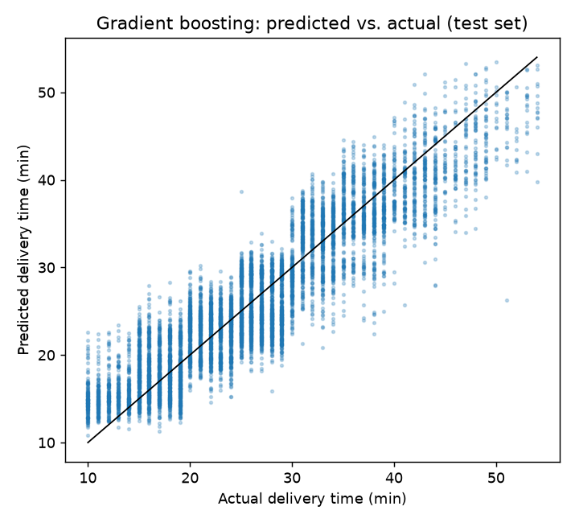
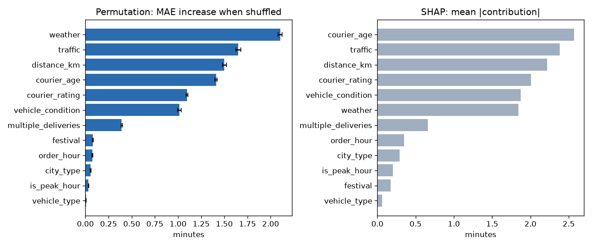

# Delivery-Time Prediction

Predicting how many minutes a food delivery will take, and finding out which factors move that number most.

**Data:** 40,353 delivery records from a public Uber Eats delivery dataset (courier age and rating, restaurant and drop-off coordinates, order and pickup times, weather, traffic, vehicle, order type, city, festival flag). Average delivery takes 26.3 min with a standard deviation of 9.4 min.

**Question:** can route conditions and courier characteristics predict delivery time well enough to be useful, and which of them matter most?

## Results

Held-out test set (8,071 deliveries, 20% split, 31 features):

| Model | R² | MAE (min) | RMSE (min) |
|---|---|---|---|
| Linear regression | 0.600 | 4.73 | 5.93 |
| Random forest | 0.835 | 3.07 | 3.81 |
| XGBoost (gradient boosting) | 0.838 | 3.05 | 3.78 |
| XGBoost on 22 principal components | 0.777 | 3.51 | 4.42 |

Gradient boosting explains 0.838 of the variance and is off by 3.05 minutes on average, against 0.600 for a linear model: the relationships are clearly non-linear. Compressing the features to 22 principal components (95% of variance) made the model worse (0.777), so the full feature set is kept.



## What drives delivery time

Two independent methods rank the features. SHAP measures each feature's average contribution to a prediction; permutation importance measures how much R² drops when a feature is shuffled. 5 of the top 5 features agree between the two.

SHAP (mean |contribution|):
1. `courier_age` (2.58 min)
2. `distance_km` (2.31 min)
3. `traffic_Low` (2.04 min)
4. `courier_rating` (1.99 min)
5. `vehicle_condition` (1.92 min)
6. `weather_Sunny` (0.96 min)

Permutation (drop in R²):
1. `distance_km` (ΔR² 0.283)
2. `courier_age` (ΔR² 0.222)
3. `courier_rating` (ΔR² 0.172)
4. `traffic_Low` (ΔR² 0.161)
5. `vehicle_condition` (ΔR² 0.158)
6. `weather_Cloudy` (ΔR² 0.099)



Takeaway: delivery time is driven by a mix of route conditions (distance, traffic) and courier factors (age, rating, vehicle condition). Weather, stacked deliveries and city add a little on top; order type and festival days barely register.

## How it works

```
data/download.py     fetch the raw CSV (not committed)
src/prepare.py       clean, compute haversine distance, pickup delay, time features; one-hot encode
src/model.py         80/20 split; linear regression, random forest, XGBoost; metrics + scatter plot
src/explain.py       SHAP and permutation importance; agreement check
src/pca.py           PCA to 95% variance, retrain XGBoost, compare
src/report.py        render this README from results/metrics.json
notebooks/01_analysis.ipynb   the same steps with charts, executed end to end
```

## Run it

```bash
python -m venv .venv && source .venv/bin/activate
pip install -r requirements.txt
./run_all.sh
```

About two minutes on a laptop. Every number above is read from `results/metrics.json`, which the run regenerates.

Data: [uber-eats-delivery-time](https://github.com/liamarguedas/uber-eats-delivery-time) (MIT).
