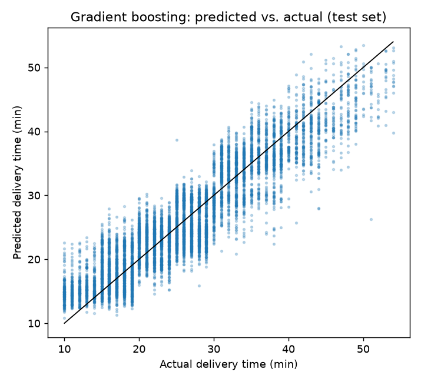
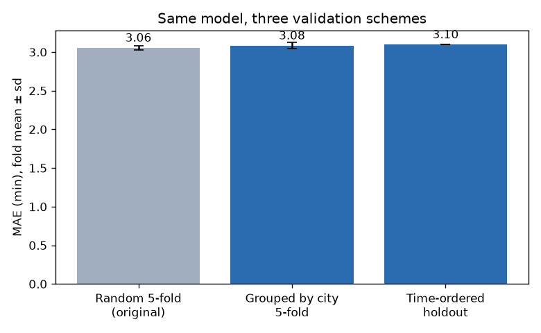
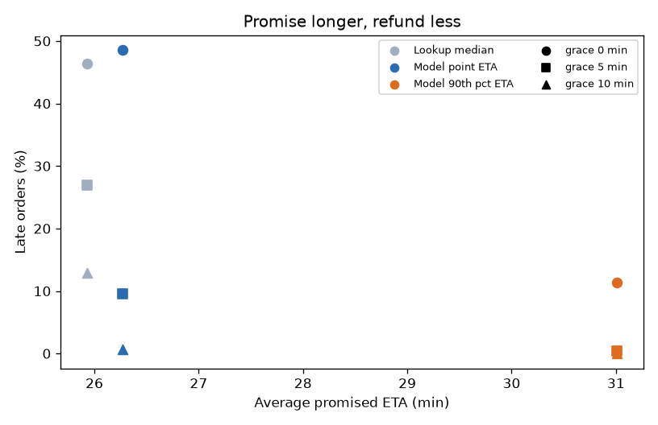
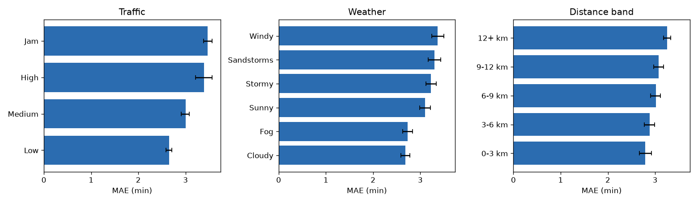
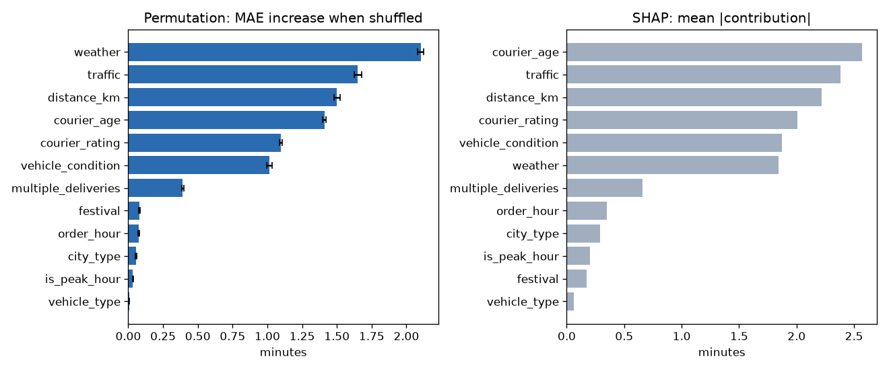

# Delivery-Time Prediction

[](https://github.com/teozkose/uber-eats-delivery-time/actions/workflows/ci.yml)

[](LICENSE)

## TL;DR

- **Question:** how long will a food delivery take, how sure can we be, and what ETA should the app promise?
- **Headline:** on {{TEST_ROWS}} orders from the last ten days (never seen in training) gradient boosting is off by **{{MAE}} min** on average (95% CI {{MAE_CI}}), {{MAE_CUT}} better than a city-and-distance lookup table; only {{OFF10}} of orders miss by 10+ minutes.
- **Decision:** promise the model's 90th-percentile time, not its point estimate: late-order refunds fall from {{COST_POINT}} to {{COST_P90}} per 1,000 orders for {{P90_EXTRA_MIN}} extra minutes on the promised ETA.

## Problem and decision

A delivery app shows every customer an ETA. Too short and late orders turn into refunds and complaints; too long and customers cancel. The operations team needs three things: an accurate estimate, a sense of how wrong it can be for a given order, and a rule for which number to show. The deciding metrics are mean absolute error in minutes, the share of orders the estimate misses by 10+ minutes, and the refund cost per 1,000 orders under each ETA policy.

## Data

- **Source:** public Uber Eats delivery-time dataset ([liamarguedas/uber-eats-delivery-time](https://github.com/liamarguedas/uber-eats-delivery-time), MIT licence), `cleaned_data.csv`, about 9 MB. Downloaded by `make data`, never committed.
- **Size and range:** {{RAW_ROWS}} orders, {{COURIERS}} couriers in {{CITIES}} cities, {{DATE_MIN}} to {{DATE_MAX}} ({{ORDER_DAYS}} order days). Mean delivery time {{TARGET_MEAN}} min (sd {{TARGET_STD}}).
- **Fields used:** courier age and rating, restaurant and drop-off coordinates, order and pickup times, weather, traffic density, vehicle type and condition, stacked deliveries, order type, festival flag, city type. The city itself is decoded from the courier id (`INDORES13DEL02` is Indore).
- **Validation** (`src/eta/validate.py`): required columns, no nulls, unique order ids, ranges for age, rating, vehicle condition, stacked deliveries and target, valid coordinates, known category values, parseable dates. Any failure stops the run with the full list.
- **Cleaning** (counts from the last run):

{{CLEANING_TABLE}}

Negative coordinates are flipped to positive first (the source stores some Indian coordinates with the wrong sign). Pickups after midnight wrap around the day instead of showing a negative delay.

## Approach

```mermaid
flowchart LR
    A[download CSV] --> B[validate schema, ranges, nulls, duplicates]
    B --> C[features: haversine distance, pickup delay, hour, weekend, peak, distance band]
    C --> D{time split}
    D -->|orders to {{TRAIN_END}}| E[train: lookup median, ridge, XGBoost + random search grouped by city, quantile GBM]
    D -->|orders from {{TEST_START}}| F[holdout]
    E --> G[evaluate: MAE/R² with bootstrap CIs, 80% interval coverage, segment errors]
    F --> G
    G --> H[permutation importance with CIs + SHAP]
    G --> I[ETA policy cost: refunds per 1,000 orders]
    H --> J[README + report page]
    I --> J
```

- **Validation that fits the data:** the headline uses a time-ordered holdout (train on {{TRAIN_ROWS}} orders up to {{TRAIN_END}}, test on {{TEST_ROWS}} orders from {{TEST_START}} to {{TEST_END}}). Hyperparameters are tuned with 3-fold cross-validation grouped by city on the training window only, so tuning never sees the test weeks and never rewards memorising a city.
- **Models:** a naive lookup (median minutes by city type and distance band), ridge regression on scaled and one-hot features, XGBoost with default settings, and XGBoost after a {{N_ITER}}-draw random search over depth, learning rate, child weight, subsampling and L2 penalty.
- **Uncertainty:** 95% bootstrap intervals (1,000 resamples of holdout orders) on MAE, R² and the off-by-10 share. Per-order 80% prediction intervals from two quantile gradient-boosting models (10th and 90th percentile, pinball loss).
- **Sensitivity check:** the refund cost depends on how much lateness customers forgive, so the policy comparison is repeated for grace windows of 0, 5 and 10 minutes.

## Results

Time-ordered holdout, {{TEST_ROWS}} orders:

{{MODEL_TABLE}}

The tuned model reached {{TUNED_CV_MAE}} min in city-grouped cross-validation; on the holdout it beats default XGBoost ({{DEFAULT_MAE}}) by a few seconds, so tuning matters far less than the move from a linear model ({{RIDGE_MAE}}) to trees. The relationships are strongly non-linear.



**Prediction intervals.** The 80% interval averages {{WIDTH}} minutes wide and covers {{COVERAGE}} of holdout orders against a {{NOMINAL}} target, between {{COV_MIN}} and {{COV_MAX}} across traffic levels: slightly too narrow, evenly so.

**Does the original random split overstate accuracy?** The first version of this project scored on a random 80/20 split. Re-scored three ways:

{{SCHEME_TABLE}}

The gap is small: the time-ordered holdout is {{SCHEME_GAP}} worse than random k-fold. Every courier works in a single city ({{COURIERS_PER_CITY}} per city on average) and the features describe conditions (traffic, weather, distance, courier profile) rather than places, so what the model learns carries across cities and across weeks. The random-split number was not inflated, but the time-ordered one is the honest figure to quote.



**What a wrong ETA costs.** An order is late when it arrives more than {{GRACE}} minutes after the promise; each late order earns a {{REFUND}} credit.

{{POLICY_TABLE}}

A point estimate is late about half the time by construction, so with no grace window it is no better than the lookup. Sensitivity to the grace window (late rate / refunds per 1,000 orders):

{{SENSITIVITY_TABLE}}

The 90th-percentile promise stays cheap at every grace window; the point estimate only wins when customers forgive a few minutes. The cost of the longer promise (cancellations at checkout) is not in this data and is the number to measure before rolling it out.



## What drives it / error analysis

Errors by segment on the holdout (bias = predicted minus actual):

{{SEGMENT_TABLE}}

Jammed and high traffic, windy and sandstorm weather, and the longest trips are where the model is least accurate; bias stays within a quarter of a minute everywhere, so no segment is systematically under-promised.



**Feature importance.** Permutation importance (rise in MAE when one feature is shuffled, 10 repeats, 95% intervals) ranks {{PERM_TOP}}; shuffling {{PERM_1}} alone adds {{PERM_1_VAL}} minutes (CI {{PERM_1_CI}}). SHAP ranks {{SHAP_TOP}}; {{OVERLAP}} of the top five agree. The weakest features are {{PERM_LAST}}.



## Limitations and next steps

- **Pickup-time ETA.** Pickup delay is known only after the courier collects the order, so this is the ETA shown at pickup. A checkout-time model would drop that feature and lose some accuracy.
- **Interval calibration.** Coverage is {{COVERAGE}} against {{NOMINAL}}; a conformal adjustment fitted on one calibration week would fix it.
- **Same couriers.** {{COURIER_OVERLAP}} of holdout orders come from couriers seen in training, so accuracy for newly hired couriers is untested; a courier-grouped split is the next check.
- **Short window.** Eight weeks of data, one season. Weather and festival effects need a longer history.
- **Assumed costs.** The {{REFUND}} credit and {{GRACE}}-minute grace window are assumptions; refund cost scales linearly with the credit, and the cancellation cost of a longer promise is not measured.
- **Library note:** `shap` is used beyond the standard stack because it gives exact per-feature contributions for tree models, a second view next to permutation importance.

## Reproduce

```bash
python -m venv .venv && source .venv/bin/activate
pip install -r requirements.txt -r requirements-dev.txt
make all        # data -> features -> run -> report -> notebook (about 2 minutes)
make test       # 8+ tests on a synthetic sample, no download
```

Every number above is read from `results/metrics.json`, which `make run` regenerates; `make report` re-renders this README and `docs/index.html`.

## Project structure

```
├── config.yaml                 paths, cleaning thresholds, model and cost parameters
├── Makefile / run_all.sh       make data | features | run | report | test | all
├── data/download.py            fetch the CSV (data files are not committed)
├── src/eta/
│   ├── data.py                 download and load raw records
│   ├── validate.py             schema, range, null and duplicate checks
│   ├── features.py             cleaning with row counts, distance, delays, time features, time split
│   ├── models.py               lookup baseline, ridge, XGBoost + random search, quantile GBM
│   ├── evaluate.py             metrics, bootstrap CIs, CV schemes, coverage, segments, ETA cost, importance
│   ├── figures.py              charts in results/
│   ├── report.py               README.md and docs/index.html from metrics.json
│   └── pipeline.py             command-line entry point
├── tests/                      pytest suite on synthetic data
├── notebooks/01_analysis.ipynb the story, importing from src/eta
├── results/                    metrics.json, segment_errors.csv, figures
└── docs/index.html             one-page report
```
